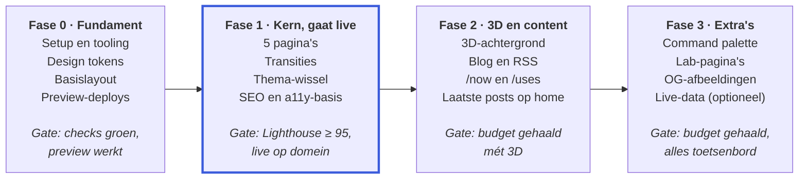

# Persoonlijke website — projectspecificatie

Oct 18, 2026 · @Lucien

## Doel en uitgangspunten

Een snelle, persoonlijke website die laat zien wie ik ben en wat ik bouw. Paginawissels voelen als een app, en één subtiele 3D-scène is het herkenbare signatuur-element.

De structuur is rustig en strak, zoals [Brittany Chiang](https://brittanychiang.com). Het speelse en persoonlijke komt van [Lynn Fisher](https://lynnandtonic.com).

**Doelen**

- **Snel:** statische HTML, geen JavaScript die de eerste weergave blokkeert.
- **Vloeiend:** de zijbalk blijft staan, de content-card morpht en de inhoud vloeit over bij elke navigatie.
- **Persoonlijk:** één signatuur-element (de 3D-scène) in plaats van overal effecten.
- **Onderhoudbaar:** een nieuw project of nieuwe post is één Markdown/MDX-bestand.

**Non-goals (niet in scope)**

- Geen CMS, geen accounts, geen database of eigen backend.
- Geen meertaligheid in de eerste versie.
- Geen volledige 3D-wereld; de scène is achtergrond, geen spel.
- Geen tracking met cookies.

**Uitgangspunt: progressive enhancement.** Alles werkt zonder JavaScript: navigatie, content en links. Transities, 3D en de command palette zijn een laag erbovenop die mag wegvallen zonder dat de site breekt.

## Tech stack

Astro met statische output, en React alleen voor de onderdelen die echt interactief zijn.

| Onderdeel | Keuze | Waarom |
| --- | --- | --- |
| Framework | Astro, laatste stabiele versie, `output: 'static'` | HTML-first, islands, ingebouwde view transitions |
| Taal | TypeScript, `strict` | Type-veilige content-schema's en componenten |
| Interactieve islands | React via `@astrojs/react` | Expertise van de eigenaar; nodig voor React Three Fiber |
| 3D | `three`, `@react-three/fiber`, `@react-three/drei` (alleen benodigde helpers) | Declaratieve 3D in React |
| Content | Markdown/MDX via `@astrojs/mdx` + content collections met Zod-schema's | Eén bestand per project of post, gevalideerd bij de build |
| Styling | CSS custom properties (design tokens) + scoped styles in `.astro` | Geen runtime-CSS, volledige controle over het ontwerp |
| Fonts | Zelf gehost via Fontsource, variable `woff2`, preload | Geen externe requests, geen layout shift |
| Code highlighting | Shiki (ingebouwd in Astro) | Highlighting tijdens de build, 0 kB JS |
| Package manager | pnpm | Snel, strikte dependencies |
| Kwaliteit | ESLint, Prettier + `prettier-plugin-astro`, `astro check` | Consistente code, typefouten vóór deploy |
| Tests | Playwright | Smoke-tests en navigatie met transities |

**Preact valt buiten scope voor versie 1.** Later kan het geëvalueerd worden voor kleine islands. De 3D-scène blijft altijd React, omdat React Three Fiber op `react-reconciler` draait en niet met Preact werkt.

## Pagina's en routes

De site start met vijf pagina's in fase 1 en groeit naar twaalf routes; alle pagina's delen dezelfde layout met zijbalk en content-card.

| Route | Pagina | Inhoud | Fase |
| --- | --- | --- | --- |
| `/` | Home | Korte intro, 3 uitgelichte projecten, laatste 3 posts (vanaf fase 2) | 1 |
| `/projects` | Projecten | Lijst van alle projecten als cards, nieuwste eerst | 1 |
| `/projects/[slug]` | Projectdetail | Cover, probleem, aanpak, resultaat, gebruikte stack, links | 1 |
| `/about` | Over mij | Bio, werkervaring als tijdlijn, skills | 1 |
| `/404` | Niet gevonden | Vriendelijke melding met links terug, in dezelfde layout | 1 |
| `/blog` | Blog | Lijst van posts met datum en tags | 2 |
| `/blog/[slug]` | Post | MDX met optionele interactieve islands | 2 |
| `/now` | Nu | Waar ik op dit moment mee bezig ben, met datum van laatste update | 2 |
| `/uses` | Setup | Hardware, software, homelab | 2 |
| `/rss.xml` | RSS-feed | Alle gepubliceerde posts | 2 |
| `/lab` | Lab | Kleine experimenten en demo's | 3 |
| `/lab/[slug]` | Experiment | Eén demo met korte uitleg | 3 |

**Navigatie in de zijbalk:** Home, Projecten, Blog, Over mij. Nu, Setup en Lab staan als secundaire links eronder. De actieve pagina krijgt `aria-current="page"` en een visuele markering.

## Layout en visueel ontwerp

Een vaste zijbalk links en één content-card rechts, met de 3D-scène als achtergrondlaag die rond beide zichtbaar is.

**Bij navigatie animeert alleen de content-card** (desktop-layout, van achter naar voor)

| Laag | Inhoud | Bij een paginawissel | Animeert |
| --- | --- | --- | --- |
| 0 · 3D-scène | Achtergrond op elke pagina | Blijft bestaan en loopt door tijdens de overgang | Nee |
| 1 · Zijbalk | Naam, intro, navigatie en thema-knop | Wordt vervangen, zonder animatie | Nee |
| 2 · Content-card: kader | De card zelf | Kader morpht in 300 ms naar de nieuwe hoogte | **Ja** |
| 2 · Content-card: inhoud (apart vastgelegd) | De tekst in de card | Oude inhoud fadet uit in 150 ms; nieuwe inhoud fadet in en schuift 8 px op (250 ms). De tekst vervormt dus niet tijdens de morph. | **Ja** |

De 3D-scène en de zijbalk staan stil tijdens een paginawissel; alleen het kader en de inhoud van de card bewegen.

**Desktop (vanaf 1024 px)**

- Twee kolommen. De zijbalk is `position: sticky`, 100vh hoog, maximaal 440 px breed.
- De zijbalk bevat naam, functietitel, intro van 1–2 zinnen, navigatie, sociale links en de thema-knop.
- De content-card staat rechts, maximaal 720 px breed, met 40 px padding en een radius van 16 px.
- De pagina scrollt als geheel; de card heeft geen eigen scrollbalk.

**Mobiel (onder 1024 px)**

- De zijbalk wordt een compacte header met naam en navigatie.
- De card is volle breedte met 16 px marge aan beide kanten en 24 px padding.
- Geen horizontale scroll, ook niet bij lange code-blokken (die scrollen binnen hun eigen blok).

**Visuele richting:** rustig, veel witruimte en duidelijke typografie. Persoonlijkheid zit in de 3D-scène, de thema-wissel en kleine micro-interacties, niet in drukke decoratie.

**Design tokens (voorstel, aan te passen)**

| Token | Donker | Licht | Gebruik |
| --- | --- | --- | --- |
| `--color-bg` | `#0B0F17` | `#F6F6F3` | Paginakleur achter alles |
| `--color-surface` | `#121826` | `#FFFFFF` | Content-card |
| `--color-text` | `#E6E9EF` | `#1A1D24` | Lopende tekst en koppen |
| `--color-text-muted` | `#8B93A7` | `#5B6170` | Datums, labels, secundaire tekst |
| `--color-border` | `#1F2737` | `#E3E4E0` | Randen van card en scheidingslijnen |
| `--color-accent` | `#7C9CFF` | `#3B5BDB` | Links, actieve navigatie, 3D-accent |

- **Spacing:** schaal op basis van 4 px (4, 8, 12, 16, 24, 32, 48, 64).
- **Radius:** 16 px voor de card, 8 px voor kleinere elementen.
- **Typografie:** één sans variable font voor alles en één mono font voor code. Body 17 px met regelafstand 1,6; koppen 22, 28 en 40 px met regelafstand 1,2.

**Dark mode:** standaard volgt de site `prefers-color-scheme`. De thema-knop overschrijft dat en bewaart de keuze in `localStorage`. Een inline script in `<head>` zet `data-theme` vóór de eerste paint, zodat er geen flits van het verkeerde thema is.

## Paginatransities

Bij elke navigatie blijft de zijbalk staan, morpht het kader van de card in 300 ms naar de nieuwe hoogte, en vloeit de inhoud over. De 3D-scène loopt ondertussen gewoon door.

**Hoe het werkt**

1. `<ClientRouter />` uit `astro:transitions` staat in de `<head>` van `BaseLayout.astro`.
2. De zijbalk krijgt `transition:name="sidebar"` en `transition:animate="none"`. Hij wordt wel vervangen (zodat de actieve link klopt), maar zonder animatie.
3. Het kader van de card (`<main>`) krijgt `transition:name="content-card"` met de standaard morph van de browser. Het kader bevat zelf geen tekst, dus het mag tijdens de morph uitrekken.
4. De inhoud van de card krijgt een eigen `transition:name="content-body"` met een custom fade. Doordat de inhoud apart wordt vastgelegd, vervormt de tekst niet tijdens de morph.
5. De container van de 3D-scène krijgt `transition:persist="scene"` plus een eigen `transition:name` met `transition:animate="none"`, zodat de canvas live blijft.

```astro
---
// src/layouts/BaseLayout.astro (uittreksel)
import { ClientRouter } from 'astro:transitions';
import { contentFade } from '../lib/transitions';
---
<html lang="nl">
  <head>
    <ClientRouter />
  </head>
  <body>
    <div class="scene" transition:persist="scene" transition:name="scene" transition:animate="none" aria-hidden="true">
      <!-- SceneLoader, zie 3D-achtergrond -->
    </div>

    <aside transition:name="sidebar" transition:animate="none">
      <!-- naam, intro, navigatie, thema-knop -->
    </aside>

    <main class="card" transition:name="content-card" transition:animate="initial">
      <div class="card-body" transition:name="content-body" transition:animate={contentFade}>
        <slot />
      </div>
    </main>
  </body>
</html>
```

```ts
// src/lib/transitions.ts
import type { TransitionDirectionalAnimations } from 'astro';

const pair = {
  old: { name: 'content-out', duration: '150ms', easing: 'ease-in', fillMode: 'both' },
  new: { name: 'content-in', duration: '250ms', delay: '100ms', easing: 'ease-out', fillMode: 'both' },
};

export const contentFade: TransitionDirectionalAnimations = {
  forwards: pair,
  backwards: pair,
};
```

```css
/* src/styles/transitions.css */
@keyframes content-out { to { opacity: 0; } }
@keyframes content-in { from { opacity: 0; transform: translateY(8px); } }

::view-transition-group(content-card) {
  animation-duration: 300ms;
  animation-timing-function: cubic-bezier(0.2, 0.8, 0.2, 1);
}
::view-transition-old(content-card),
::view-transition-new(content-card) { height: 100%; }

/* De rest van de pagina (alleen achtergrond) niet laten overvloeien */
::view-transition-old(root),
::view-transition-new(root) { animation: none; }

@media (prefers-reduced-motion: reduce) {
  ::view-transition-group(*),
  ::view-transition-old(*),
  ::view-transition-new(*) { animation: none !important; }
}
```

**Prefetch:** zet in `astro.config.mjs` `prefetch: { prefetchAll: true, defaultStrategy: 'hover' }`. Dan is de volgende pagina meestal al geladen voordat er geklikt wordt.

**Valkuilen voor de bouwer**

- Scripts die bij het laden van een pagina iets doen, luisteren naar `astro:page-load` in plaats van `DOMContentLoaded`. Anders draaien ze na een navigatie niet opnieuw.
- Het thema (`data-theme` op `<html>`) moet opnieuw gezet worden in `astro:after-swap`, anders springt het na een navigatie terug.
- Elke `transition:name` is uniek per pagina. Twee elementen met dezelfde naam op één pagina breken de transitie.
- De standaard animaties van Astro moeten mogelijk overschreven worden; controleer in DevTools (Animations-paneel) welke animatie echt draait.

**Acceptatiecriteria**

- [ ] Bij navigatie tussen twee willekeurige pagina's beweegt de zijbalk niet.
- [ ] Het kader van de card verandert soepel van hoogte; de tekst vervormt niet.
- [ ] De hele transitie duurt maximaal 350 ms.
- [ ] De terugknop van de browser speelt dezelfde transitie en herstelt de scrollpositie.
- [ ] Met `prefers-reduced-motion: reduce` wisselt de pagina zonder animatie.
- [ ] Zonder JavaScript werkt navigatie via gewone page loads.
- [ ] In een browser zonder View Transitions API werkt navigatie zonder fouten in de console.
- [ ] De 3D-scène blijft doorlopen tijdens de overgang, zonder flits of ghosting.
- [ ] Na navigatie wordt de nieuwe pagina aangekondigd voor screenreaders en staat de focus bovenaan de nieuwe inhoud.

## 3D-achtergrond

Eén subtiele 3D-scène achter de content, op elke pagina, die blijft draaien tijdens navigatie en de eerste weergave nooit vertraagt.

**Concept (eerste voorstel):** één abstract object of een kleine groep vormen in de accentkleur. Het draait langzaam en kantelt licht mee met de muispositie. Het exacte concept is een open vraag voor de eigenaar.

**Laadstrategie**

1. De pagina toont eerst een statische fallback: een CSS-gradiënt of een poster-afbeelding (AVIF/WebP) van de scène.
2. `SceneLoader.tsx` wordt geladen met `client:only="react"`, omdat WebGL niet op de server kan renderen.
3. `SceneLoader` wacht op `requestIdleCallback` (fallback: `setTimeout` van 1 s) en laadt dan pas `SceneCanvas.tsx` via `React.lazy(() => import(...))`. Zo komt three.js in een aparte chunk die de eerste weergave niet raakt.
4. Zodra de eerste frame gerenderd is, fadet de canvas in 600 ms in over de fallback.

```astro
<div class="scene" transition:persist="scene" transition:name="scene" transition:animate="none" aria-hidden="true">
  <SceneLoader client:only="react" />
</div>
```

**Plaatsing:** `position: fixed; inset: 0; z-index: 0`, met zijbalk en card erboven. De container heeft `pointer-events: none`; de muispositie wordt gelezen via een `pointermove`-listener op `window`.

**Performance-regels**

- Device pixel ratio begrensd op `[1, 1.5]` via `dpr` op de `<Canvas>`.
- Renderen pauzeert als het tabblad verborgen is (`visibilitychange`).
- Geen post-processing in versie 1.
- De 3D-chunk (three + R3F + gebruikte drei-helpers) is maximaal 250 kB gzip.
- Doel: stabiel 60 fps op een gemiddelde laptop, zonder merkbare invloed op scrollen.

**Wanneer de scène níet laadt (alleen de statische fallback)**

- `prefers-reduced-motion: reduce`: de scène toont één stilstaande frame of alleen de fallback.
- Schermbreedte onder 768 px.
- `navigator.connection.saveData` is `true`.
- WebGL is niet beschikbaar.

**Thema:** de scène leest `--color-accent` en `--color-bg` uit de CSS en past kleuren aan als `data-theme` verandert (via een `MutationObserver` op `<html>` of een custom event `theme-change`).

**Acceptatiecriteria**

- [ ] De LCP van een pagina met en zonder 3D verschilt minder dan 100 ms.
- [ ] De scène herstart niet bij navigatie; de rotatie loopt naadloos door.
- [ ] Elk van de vier uitzonderingen hierboven toont alleen de fallback, zonder fouten.
- [ ] Bij het wisselen van thema verandert de scène binnen één frame mee.
- [ ] De scène is decoratief (`aria-hidden="true"`) en niet bereikbaar met het toetsenbord.

## Overige interactieve onderdelen

Drie extra onderdelen, elk met de lichtst mogelijke techniek: de thema-wissel in vanilla JS, de command palette als React-island en de live-data widget als optionele uitbreiding.

### Thema-wissel met cirkel-reveal (fase 1)

Bij een klik op de thema-knop breidt het nieuwe thema zich als cirkel uit vanaf de knop. Dit is een klein inline script in `ThemeToggle.astro`, zonder React.

```ts
function toggleTheme(e: MouseEvent) {
  const root = document.documentElement;
  const next = root.dataset.theme === 'dark' ? 'light' : 'dark';
  const apply = () => { root.dataset.theme = next; localStorage.setItem('theme', next); };
  const reduce = matchMedia('(prefers-reduced-motion: reduce)').matches;
  if (!document.startViewTransition || reduce) return apply();

  const { clientX: x, clientY: y } = e;
  const r = Math.hypot(Math.max(x, innerWidth - x), Math.max(y, innerHeight - y));
  root.classList.add('theme-transition');
  const t = document.startViewTransition(apply);
  t.ready.then(() => root.animate(
    { clipPath: [`circle(0 at ${x}px ${y}px)`, `circle(${r}px at ${x}px ${y}px)`] },
    { duration: 450, easing: 'ease-out', pseudoElement: '::view-transition-new(root)' },
  ));
  t.finished.finally(() => root.classList.remove('theme-transition'));
}
```

- Tijdens de wissel zet `.theme-transition * { view-transition-name: none !important; }` alle benoemde elementen tijdelijk uit. Zo wordt de hele pagina in één keer onthuld, in plaats van dat card en zijbalk apart overvloeien.
- De root-regel in `transitions.css` krijgt ook `mix-blend-mode: normal`, zodat de cirkel scherp is.
- Het script koppelt de click-listener in `astro:page-load`, zodat hij na elke navigatie werkt.
- Zonder View Transitions API of met reduced motion wisselt het thema direct.

### Command palette (fase 3)

- Opent met ⌘K of Ctrl+K, en met een zichtbare knop in de zijbalk voor muis- en touchgebruikers.
- React-island op basis van [`cmdk`](https://github.com/pacocoursey/cmdk), geladen met `client:idle` en `transition:persist`, zodat hij niet bij elke navigatie opnieuw hydrateert.
- Bevat pagina's, projecten en posts (alleen titel en URL, als props doorgegeven tijdens de build), plus acties: thema wisselen en e-mailadres kopiëren.
- Navigeert met `navigate()` uit `astro:transitions/client`, zodat de paginatransitie gewoon afspeelt.
- Volledig met toetsenbord te bedienen: pijltjes, Enter, Esc; focus blijft binnen de palette zolang die open is.

### Live-data widget (fase 3, optioneel)

- Bijvoorbeeld "nu aan het luisteren", recente GitHub-activiteit of een status uit de homelab. De bron is een open vraag.
- De browser haalt data op bij een eigen klein endpoint (bijvoorbeeld een serverless function) dat tokens bewaart en 60 seconden cachet.
- Nooit secrets in de frontend, en Home Assistant of andere homelab-diensten nooit rechtstreeks aan internet blootstellen.
- Geladen met `client:visible`; toont een skeleton tijdens het laden en verbergt zichzelf bij een fout.

### Micro-interacties (fase 1)

Alleen CSS: projectcards komen 2 px omhoog en krijgen een accentrand bij hover en focus, links krijgen een geanimeerde onderstreping. Alles staat uit bij `prefers-reduced-motion`.

## Contentmodel

Alle content staat als bestanden in de repo en wordt bij de build gevalideerd met Zod-schema's in `src/content.config.ts`; een fout in de frontmatter laat de build falen.

| Collectie | Bron | Velden |
| --- | --- | --- |
| `projects` | `src/content/projects/*.mdx` | `title`, `summary` (max 160 tekens), `date`, `role`, `stack[]`, `cover`, `coverAlt`, `links.live?`, `links.repo?`, `featured`, `draft` |
| `posts` | `src/content/posts/*.mdx` | `title`, `description` (max 160 tekens), `pubDate`, `updatedDate?`, `tags[]`, `draft` |
| `lab` | `src/content/lab/*.mdx` | `title`, `description`, `date`, `draft` |
| `experience` | `src/content/experience.json` | `company`, `role`, `start`, `end?`, `summary`, `stack[]` |

`/now` en `/uses` zijn losse MDX-pagina's in `src/pages/` met een `updated`-datum in de frontmatter.

```ts
// src/content.config.ts (uittreksel)
import { defineCollection } from 'astro:content';
import { glob, file } from 'astro/loaders';
import { z } from 'astro/zod';

const projects = defineCollection({
  loader: glob({ pattern: '**/*.{md,mdx}', base: './src/content/projects' }),
  schema: ({ image }) => z.object({
    title: z.string(),
    summary: z.string().max(160),
    date: z.coerce.date(),
    role: z.string(),
    stack: z.array(z.string()),
    cover: image(),
    coverAlt: z.string().min(1),
    links: z.object({
      live: z.string().url().optional(),
      repo: z.string().url().optional(),
    }).default({}),
    featured: z.boolean().default(false),
    draft: z.boolean().default(false),
  }),
});

const experience = defineCollection({
  loader: file('./src/content/experience.json'),
  schema: z.object({
    company: z.string(),
    role: z.string(),
    start: z.coerce.date(),
    end: z.coerce.date().optional(),
    summary: z.string(),
    stack: z.array(z.string()),
  }),
});

export const collections = { projects, experience /*, posts, lab */ };
```

**Regels**

- Items met `draft: true` zijn alleen zichtbaar in development, nooit in de productie-build.
- De slug is de bestandsnaam.
- Projecten sorteren op `date`, nieuwste eerst; de homepage toont maximaal 3 projecten met `featured: true`.
- Afbeeldingen gaan via `astro:assets` (`<Image>` of `<Picture>`) en worden als AVIF/WebP met vaste breedte en hoogte uitgeleverd.
- `coverAlt` is verplicht, zodat geen enkele afbeelding zonder alt-tekst live gaat.

**Startcontent**

De eigenaar levert de echte teksten aan. Tot die tijd gebruikt de bouwer duidelijk herkenbare placeholders, gemarkeerd met `TODO(content)`.

- [ ] Project 1: deze website zelf (stack, keuzes, transities, 3D).
- [ ] Project 2 en 3: werk- of side projects, beschreven als probleem, aanpak en resultaat.
- [ ] Werkervaring voor `/about`.
- [ ] Eerste post (fase 2): "Hoe ik deze site bouwde".
- [ ] `/uses`: setup, tools en de homelab.

## Performance, toegankelijkheid en SEO

Elke fase wordt pas afgerond als de site binnen deze budgetten blijft, gemeten op een mobiel profiel (Lighthouse, gesimuleerde 4G).

**Performance-budget**

| Meting | Doel |
| --- | --- |
| Lighthouse Performance (mobiel) | ≥ 95 |
| Largest Contentful Paint | ≤ 1,8 s |
| Cumulative Layout Shift | ≤ 0,05 |
| Interaction to Next Paint | ≤ 200 ms |
| JavaScript dat de eerste weergave blokkeert | 0 kB (alleen het inline thema-script, < 1 kB) |
| Totale JavaScript na idle, zonder 3D | ≤ 100 kB gzip |
| 3D-chunk, pas geladen na idle | ≤ 250 kB gzip |
| CSS per pagina | ≤ 30 kB gzip |
| Fonts | Maximaal 2 bestanden, `woff2`, Latin-subset, `font-display: swap` |

**Toegankelijkheid (WCAG 2.2 niveau AA)**

- Tekstcontrast minimaal 4,5:1 in beide thema's, ook voor `--color-text-muted`.
- Alles is met het toetsenbord te bedienen, met een duidelijk zichtbare focusstijl.
- Een skip-link "Naar inhoud" als eerste focusbare element.
- Semantische landmarks: `<header>` of `<aside>`, `<nav>`, `<main>`, `<footer>`.
- `lang` op `<html>`, `aria-current="page"` op de actieve navigatielink.
- Alle animaties respecteren `prefers-reduced-motion`.
- Elke afbeelding heeft een betekenisvolle alt-tekst; decoratieve elementen hebben `aria-hidden="true"`.

**SEO en delen**

- Unieke `<title>` en meta description per pagina, plus een canonical URL.
- Open Graph- en Twitter-meta met een standaard OG-afbeelding van 1200 × 630 px; gegenereerde OG-afbeeldingen per post volgen in fase 3.
- `sitemap.xml` via `@astrojs/sitemap`, RSS via `@astrojs/rss`, en een `robots.txt`.
- JSON-LD van het type `Person` op de homepage.

## Projectstructuur

Statische onderdelen zijn `.astro`-bestanden; React (`.tsx`) staat uitsluitend in `src/islands/`, zodat in één oogopslag zichtbaar is wat JavaScript naar de browser stuurt.

```text
.
├── astro.config.mjs
├── package.json
├── tsconfig.json
├── public/
│   ├── favicon.svg
│   ├── og-default.png
│   └── robots.txt
├── src/
│   ├── content.config.ts
│   ├── content/
│   │   ├── projects/
│   │   ├── posts/
│   │   ├── lab/
│   │   └── experience.json
│   ├── layouts/
│   │   └── BaseLayout.astro      # ClientRouter, scène, zijbalk, card
│   ├── components/
│   │   ├── Sidebar.astro
│   │   ├── ContentCard.astro
│   │   ├── ProjectCard.astro
│   │   ├── ThemeToggle.astro     # vanilla script, geen React
│   │   └── Seo.astro
│   ├── islands/                  # alleen React, alleen wat interactief is
│   │   ├── CommandPalette.tsx
│   │   └── scene/
│   │       ├── SceneLoader.tsx   # wacht op idle, lazy import
│   │       └── SceneCanvas.tsx   # R3F Canvas en objecten
│   ├── lib/
│   │   ├── transitions.ts        # custom transitie-animaties
│   │   └── theme.ts
│   ├── pages/
│   │   ├── index.astro
│   │   ├── about.astro
│   │   ├── projects/index.astro
│   │   ├── projects/[...slug].astro
│   │   ├── blog/index.astro
│   │   ├── blog/[...slug].astro
│   │   ├── lab/index.astro
│   │   ├── lab/[...slug].astro
│   │   ├── now.mdx
│   │   ├── uses.mdx
│   │   ├── 404.astro
│   │   └── rss.xml.ts
│   └── styles/
│       ├── tokens.css            # kleuren, spacing, typografie
│       ├── global.css
│       └── transitions.css
└── tests/
    └── navigation.spec.ts        # Playwright
```

**Conventies**

- Elke `client:*`-directive krijgt een korte comment met waarom die nodig is en waarom deze strategie.
- Kleuren, spacing en fontgroottes komen altijd uit `tokens.css`; geen losse hexwaarden in componenten.
- Componenten zijn klein en hebben één taak; props zijn getypeerd met een `Props`-interface.
- Commits volgen Conventional Commits (`feat:`, `fix:`, `chore:`, `docs:`).

## Bouwfases

Vier fases, elk afgesloten met een werkende, gedeployde site; fase 1 is de eerste versie die live gaat.

**Fase 1 is de eerste versie die live gaat.** Elke fase eindigt met een gate; pas daarna begint de volgende.



Fase 0 levert nog niets publieks op; vanaf de gate van fase 1 staat de site live en groeit hij per fase.

### Fase 0: Fundament

- [ ] Astro-project met TypeScript strict, pnpm, ESLint, Prettier en `astro check`.
- [ ] `tokens.css` met kleuren, spacing en typografie voor beide thema's; fonts zelf gehost.
- [ ] `BaseLayout.astro` met zijbalk en content-card, responsief, nog zonder transities.
- [ ] Automatische preview-deploy per branch.
- [ ] **Gate:** de preview-URL werkt, en `astro check`, lint en build zijn groen.

### Fase 1: Kern (eerste live versie)

- [ ] Pagina's `/`, `/projects`, `/projects/[slug]`, `/about` en `/404`.
- [ ] Content collections `projects` en `experience` met schema's en placeholder-content.
- [ ] Paginatransities volgens de sectie Paginatransities, inclusief alle acceptatiecriteria.
- [ ] Thema-wissel met cirkel-reveal, zonder flits bij laden of navigeren.
- [ ] Micro-interacties, skip-link, focusstijlen en SEO-basis (meta, canonical, sitemap, OG-standaardafbeelding).
- [ ] Playwright-test die door alle pagina's navigeert en controleert dat er geen console-fouten zijn.
- [ ] **Gate:** Lighthouse mobiel ≥ 95 op alle pagina's, alle budgetten gehaald, live op het productiedomein.

### Fase 2: 3D en content

- [ ] 3D-achtergrond volgens de sectie 3D-achtergrond, inclusief fallback en uitzonderingen.
- [ ] Blog: collectie `posts`, `/blog`, `/blog/[slug]`, RSS-feed.
- [ ] Pagina's `/now` en `/uses`.
- [ ] Homepage toont de laatste 3 posts.
- [ ] **Gate:** budgetten nog steeds gehaald mét 3D; LCP met en zonder 3D verschilt minder dan 100 ms.

### Fase 3: Extra's

- [ ] Command palette (⌘K / Ctrl+K).
- [ ] Lab: collectie `lab`, `/lab` en `/lab/[slug]`, met minimaal één experiment.
- [ ] Gegenereerde OG-afbeeldingen per post.
- [ ] Optioneel: live-data widget, na keuze van de bron door de eigenaar.
- [ ] Optioneel: evaluatie of kleine islands naar Preact kunnen (niet de 3D-scène).
- [ ] **Gate:** budgetten gehaald, alle nieuwe onderdelen met toetsenbord bedienbaar.

## Deployment en hosting

Voorstel: de statische build hosten op Cloudflare, met automatische preview-deploys per branch en productie-deploys vanaf `main`. Het Astro-team is sinds januari 2026 onderdeel van Cloudflare ([persbericht](https://secure.businesswire.com/news/home/20260116386991/en/Cloudflare-Acquires-Astro-to-Accelerate-the-Future-of-High-Performance-Web-Development)); Astro blijft open source en op elk platform te hosten.

| Optie | Voordelen | Nadelen |
| --- | --- | --- |
| Cloudflare (voorstel) | Gratis tier, wereldwijd CDN, preview per branch, sluit aan bij DNS via Cloudflare | Vendor-specifieke instellingen voor headers en redirects |
| Netlify of Vercel | Vergelijkbare preview-flow, veel documentatie | Ander platform dan de DNS |
| Eigen homelab (Docker + Caddy, via Cloudflare Tunnel) | Volledige controle, geen derde partij | Beschikbaarheid hangt af van de thuisverbinding en hardware; meer onderhoud |

**Pipeline bij elke push**

1. `pnpm install --frozen-lockfile`
2. `astro check` en lint
3. `astro build`
4. Deploy naar preview (branch) of productie (`main`)
5. Playwright-smoke-tests tegen de preview-URL

**Caching:** bestanden in `/_astro/` hebben een hash in de naam en krijgen `Cache-Control: public, max-age=31536000, immutable`. HTML krijgt een korte cache met revalidatie, zodat een nieuwe deploy direct zichtbaar is.

## Open vragen voor de eigenaar

Deze keuzes zijn nog niet gemaakt; de eerste vier zijn nodig vóór fase 1, de rest kan later.

- [ ] **Taal:** Nederlands, Engels of beide? Dit bepaalt `lang`, teksten en of er later i18n nodig is.
- [ ] **Domein:** op welk domein of subdomein komt de site?
- [ ] **Font:** welke sans en welke mono? Voorstel: Inter Variable en JetBrains Mono, of Geist en Geist Mono.
- [ ] **Accentkleur:** blijft het voorgestelde blauw, of een eigen kleur?
- [ ] **Projecten:** welke 3 projecten staan in fase 1 op de site?
- [ ] **3D-concept:** abstract object, deeltjes, of een kleine 3D-versie van je bureau of setup?
- [ ] **Styling:** eigen CSS met tokens (voorstel) of toch Tailwind?
- [ ] **Hosting:** Cloudflare (voorstel) of de eigen homelab?
- [ ] **Analytics:** geen, of privacyvriendelijk zonder cookies (bijvoorbeeld Cloudflare Web Analytics, Plausible of een zelf gehoste Umami)?
- [ ] **Live-data widget:** welke bron, als die er komt?

## Werkafspraken voor de bouwer

Werk fase voor fase, rapporteer na elke fase, en kies bij twijfel de rustigste en lichtste oplossing. Dit geldt zowel voor een developer als voor een AI-coding-agent.

1. **Lees eerst het hele document.** De volgorde van de fases is bindend; werk niet vooruit naar een volgende fase.
2. **Stop na elke fase** en lever een kort rapport: wat er gebouwd is, de gemeten budget-cijfers, en welke acceptatiecriteria (nog) niet gehaald zijn.
3. **Geen nieuwe dependencies** buiten de tech stack zonder akkoord van de eigenaar.
4. **Standaard geen JavaScript.** Elke `client:*`-directive moet te verdedigen zijn; een statische oplossing gaat altijd voor.
5. **Nooit content verzinnen.** Gebruik duidelijk herkenbare placeholders met `TODO(content)`; geen fictieve projecten, werkgevers of resultaten die echt lijken.
6. **Open vragen niet zelf beslissen.** Kies tijdelijk het voorstel uit dit document, markeer het met `TODO(beslissing)` en noem het in het fase-rapport.
7. **Testen in meerdere browsers:** de laatste versies van Chrome, Safari en Firefox, plus iOS Safari en Chrome op Android.
8. **Toegankelijkheid testen:** elke pagina en elke interactie met alleen het toetsenbord, en één keer met een screenreader (VoiceOver of NVDA).
9. **Kleine commits** per onderdeel, met Conventional Commits, zodat elke stap terug te draaien is.
10. **Bij afwijken van dit document:** leg kort uit waarom, en pas de betreffende sectie aan of noteer het als open vraag.
