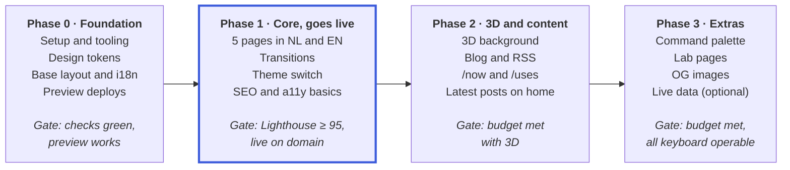

# Personal website — project specification

Oct 18, 2026 · @Lucien

## Goals and principles

A fast, personal website that shows who I am and what I build. Page changes feel like an app, and one subtle background, the card starfield, is the recognizable signature element.

The structure is calm and clean, like [Brittany Chiang](https://brittanychiang.com). The playful, personal touch comes from [Lynn Fisher](https://lynnandtonic.com).

**Goals**

- **Fast:** static HTML, no JavaScript that blocks the first render.
- **Smooth:** the sidebar stays put; on every navigation the old card falls away to the bottom and the new one drops in from the top.
- **Personal:** one signature element (the card starfield) instead of effects everywhere.
- **Bilingual:** all content in Dutch and English from the first live version; Dutch is the default.
- **Maintainable:** a new project or post is a single Markdown/MDX file per language.

**Non-goals (out of scope)**

- No CMS, no accounts, no database or custom backend.
- No languages beyond Dutch and English, and no automatic redirect based on the browser language; visitors switch language themselves.
- No full 3D world; the scene is a background, not a game.
- No tracking with cookies.

**Principle: progressive enhancement.** Everything works without JavaScript: navigation, content, links and the language switch. Transitions, 3D and the command palette are a layer on top that can drop away without breaking the site.

## Tech stack

Astro with static output, and React only for the parts that are truly interactive.

| Part | Choice | Why |
| --- | --- | --- |
| Framework | Astro, latest stable version, `output: 'static'` | HTML-first, islands, built-in view transitions |
| Language | TypeScript, `strict` | Type-safe content schemas and components |
| Interactive islands | React via `@astrojs/react` | The owner's expertise |
| Background | Canvas 2D + CSS 3D transforms, self-built, no library (changed in phase 2 from three.js + React Three Fiber) | The card starfield needs only small shapes and perspective math: a few kB instead of a 250 kB 3D chunk |
| Content | Markdown/MDX via `@astrojs/mdx` + content collections with Zod schemas | One file per project or post per language, validated at build time |
| i18n | Astro's built-in i18n routing | No extra dependency; locale-aware URLs and `Astro.currentLocale` |
| Styling | CSS custom properties (design tokens) + a CSS Module per component (`Component.module.css`, since phase 1, at the owner's request) | No runtime CSS, full control over the design, styles in their own files |
| Fonts | Self-hosted via Fontsource, variable `woff2`, preloaded | No external requests, no layout shift |
| Code highlighting | Shiki (built into Astro) | Highlighting at build time, 0 kB JS |
| Package manager | npm | Comes with Node, so there is no extra tool to install (changed from pnpm on Oct 18, 2026) |
| Quality | ESLint, Prettier + `prettier-plugin-astro`, `astro check`, a Husky pre-push hook that runs them all (added Oct 18, 2026) | Consistent code, type errors caught before a push or deploy |
| Tests | Playwright | Smoke tests, navigation with transitions, and screenshot comparisons for refactors (`toHaveScreenshot`, since phase 2) |

**Preact is out of scope for version 1.** It can be evaluated later for small islands. The starfield isn't an island: it's a plain script, so it doesn't depend on React or Preact.

## Pages and routes

The site starts with five pages in phase 1 and grows to twelve routes; all pages share the same layout with sidebar and content card.

**Languages:** every page exists in Dutch and English. Dutch is the default and has no prefix; English lives under `/en/` (for example `/projects` and `/en/projects`). A project, post or experiment has the same slug in both languages. The table below lists the Dutch paths.

```js
// astro.config.mjs (excerpt)
export default defineConfig({
  output: 'static',
  i18n: {
    defaultLocale: 'nl',
    locales: ['nl', 'en'],
    routing: { prefixDefaultLocale: false },
  },
});
```

| Route | Page | Content | Phase |
| --- | --- | --- | --- |
| `/` | Home | Short intro, 3 featured projects, latest 3 posts (from phase 2) | 1 |
| `/projects` | Projects | List of all projects as cards, newest first | 1 |
| `/projects/[slug]` | Project detail | Cover, problem, approach, result, stack used, links | 1 |
| `/about` | About me | Bio, work experience as a timeline, skills | 1 |
| `/404` | Not found | Friendly message in both languages with links back to both home pages, in the same layout (static hosts serve a single 404 page) | 1 |
| `/blog` | Blog | List of posts with date and tags | 2 |
| `/blog/[slug]` | Post | MDX with optional interactive islands | 2 |
| `/now` | Now | What I'm working on right now, with the date of the last update | 2 |
| `/uses` | Uses | Hardware, software, homelab | 2 |
| `/rss.xml` | RSS feed | All published posts; one feed per language (`/rss.xml` and `/en/rss.xml`) | 2 |
| `/lab` | Lab | Small experiments and demos | 3 |
| `/lab/[slug]` | Experiment | One demo with a short explanation | 3 |

**Sidebar navigation:** Home, Projects, Blog, About. Now, Uses and Lab are secondary links below them. The active page gets `aria-current="page"` and a visual marker. A language switch (NL / EN) links to the same page in the other language.

## Layout and visual design

A fixed sidebar on the left and one content card on the right, with the card starfield as a background layer that is visible around both.

**On navigation the card is handed off, and the starfield plays along** (desktop layout, back to front; since phase 2)

| Layer | Contents | On a page change | Animates |
| --- | --- | --- | --- |
| 0 · Card starfield (canvas) | Tiny card-shaped stars on every page | Persists and keeps running; one star leaves and one returns (sections 1 and 4 in Page transitions) | **Yes**, in the background |
| 1 · Sidebar | Name, intro, navigation and theme toggle | Replaced, without animation | No |
| 2 · Content card, old | The card with its content | Falls away to the bottom and fades (section 3) | **Yes** |
| 2 · Content card, new | The card with its content | Drops in from the top and fades in, content visible from the start (section 2) | **Yes** |

The sidebar stays still during a page change; the card and the starfield move.

**Desktop (64em and up: 1024 px at the default font size)**

- Two columns. The sidebar is `position: sticky`, 100vh tall, at most 440 px wide.
- The sidebar contains name, job title, a 1–2 sentence intro and navigation at the top; the language switch and theme toggle at the bottom, with the footer (social links, copyright, source code link) below them (changed in phase 1).
- The content card sits on the right, at most 720 px wide, with 40 px padding and a 16 px radius.
- The page scrolls as a whole; the card has no scrollbar of its own.

**Mobile (below 64em)**

- The sidebar becomes a compact header with the name, the language switch and the theme toggle; it scrolls away with the page. (The owner decided in phase 1 to keep the language switch and theme toggle here rather than in the nav island, for now.)
- The navigation is a "nav island" (changed in phase 1, at the owner's request): a partly see-through, blurred pill fixed to the bottom of the screen, within thumb reach, clear of the iPhone home indicator (`env(safe-area-inset-bottom)`). It stays put during a page transition, like the desktop sidebar; only its current-page marker slides to the new item. Links are at least 44 px tall, and pages leave room at the bottom so the island never covers content.
- The footer sits below the card.
- The card is full width with a 16 px margin on both sides and 24 px padding.
- No horizontal scrolling, not even with long code blocks (those scroll within their own block).

**Visual direction:** calm, plenty of whitespace and clear typography. The personality lives in the card starfield, the theme switch and small micro-interactions, not in busy decoration.

**Design tokens (proposal, open to change)**

| Token | Dark | Light | Use |
| --- | --- | --- | --- |
| `--color-bg` | `#0B0F17` | `#F6F6F3` | Page color behind everything |
| `--color-surface` | `#121826` | `#FFFFFF` | Content card |
| `--color-text` | `#E6E9EF` | `#1A1D24` | Body text and headings |
| `--color-text-muted` | `#8B93A7` | `#5B6170` | Dates, labels, secondary text |
| `--color-border` | `#1F2737` | `#E3E4E0` | Card borders and dividers |
| `--color-accent` | `#7C9CFF` | `#3B5BDB` | Links, active navigation |

- **Spacing:** a scale based on 4 px (4, 8, 12, 16, 24, 32, 48, 64), plus a 2 px half step.
- **Radius:** 16 px for the card, 8 px for smaller elements.
- **Units (since phase 1):** every size in this document is the value at the browser's default font size (16 px). In `tokens.css` sizes and spacing are in rem (`--space-4: 1rem`, `--size-icon: 1.25rem`) and the breakpoint is in em (`64em`), so the whole layout grows with a visitor's font-size setting, not only the text; with large text the one-column layout starts at a wider window. Only hairlines stay in px: 1 px borders, 2 px focus rings and underlines, and shadow offsets and blurs. A Playwright test checks the pages at a 150% default font size.
- **Typography:** one sans variable font for everything and one mono font for code. Body 17 px with a 1.6 line height; headings 22, 28 and 40 px with a 1.2 line height.

**Dark mode:** by default the site follows `prefers-color-scheme`. The theme toggle overrides that and stores the choice in `localStorage`. An inline script in `<head>` sets `data-theme` before the first paint, so there is no flash of the wrong theme. In `tokens.css` every color is a `light-dark(<light>, <dark>)` value, so `data-theme` only has to switch `color-scheme` (done since phase 0).

## Page transitions

On every navigation the sidebar stays put and the content card is handed off: the old card falls away to the bottom and the new card drops in from the top. Meanwhile the card starfield keeps running and plays along: one star leaves the field before the new card arrives, and one returns to it after the old card has gone. (Since phase 2; this replaces the phase 1 morph of the card's frame. The timings were tuned in a prototype with the owner on Oct 24, 2026.)

**The four sections**

| # | What | Where | Time | Movement | Easing |
| --- | --- | --- | --- | --- | --- |
| 1 | A star leaves the background | Starfield canvas | 0–200 ms | A star near the sidebar grows to 32 px tall, drifts 30 px sideways and leaves past the top edge | Ease-in (quadratic) |
| 2 | The new card arrives | View transition, `::view-transition-new(content-card)` | 200–600 ms | From 40vh above, `scale(0.8)` and `rotateX(40deg)` to its place; fades in during the first 55%. The content is visible from the start (no empty card) | Ease-out (cubic) |
| 3 | The old card leaves | View transition, `::view-transition-old(content-card)` | 0–300 ms | Falls 80vh down to `scale(0.8)` and `rotateX(-40deg)`; fades out quickly at first while the fall speeds up | Movement ease-in (quadratic), fade ease-out (quadratic) |
| 4 | A star returns to the background | Starfield canvas | 330–1230 ms | A card outline flows in from below the bottom edge, travels low and rises late into the starfield next to the card, shrinking until it's a star | In-out (cubic) |

Both cards use `perspective(1000px)`. The text of the new page is readable after about 420 ms and the cards are settled at 600 ms. Sections 1 and 4 are not part of the view transition: the page is usable at 600 ms, and the background settles on its own until 1230 ms. The canvas side of sections 1 and 4 is described under 3D background: card starfield.

**How it works**

1. `<ClientRouter />` from `astro:transitions` is in the `<head>` of `BaseLayout.astro`.
2. The sidebar gets `transition:name="sidebar"` and `transition:animate="none"`. It is still replaced (so the active link is correct), but without animation.
3. The card (`<main>`) gets `transition:name="content-card"` with the custom `cardHandoff` animation (sections 2 and 3). Its group doesn't animate (no morph): the old and new snapshots move independently, each at its own size. The content is part of the card's snapshot, so it needs no name of its own.
4. The starfield's container gets `transition:persist="starfield"` plus its own `transition:name` with `transition:animate="none"`, so the canvas stays live.
5. The starfield starts sections 1 and 4 on `astro:after-swap`, which runs right before the view transition's animations start. Check in DevTools (Animations panel and a performance recording) that the canvas and the cards line up.
6. On mobile (since phase 1): the nav island gets `view-transition-name: nav-island` with no animation, and its current-page marker gets `nav-marker`, which slides from the old item to the new one. The footer below the card gets `site-footer` and moves with the cards. The sidebar's own name is turned off on mobile: an element with a view-transition-name is a stacking context, which would put the fixed island below the card.

```astro
---
// src/layouts/BaseLayout.astro (excerpt)
import { ClientRouter } from 'astro:transitions';
import { cardHandoff } from '@/lib/transitions';
---
<html lang={Astro.currentLocale}>
  <head>
    <ClientRouter />
  </head>
  <body>
    <div class="starfield" transition:persist="starfield" transition:name="starfield" transition:animate="none" aria-hidden="true">
      <!-- Starfield, see 3D background: card starfield -->
    </div>

    <aside transition:name="sidebar" transition:animate="none">
      <!-- name, intro, navigation, language switch, theme toggle -->
    </aside>

    <main class="card" transition:name="content-card" transition:animate={cardHandoff}>
      <slot />
    </main>
  </body>
</html>
```

```ts
// src/lib/transitions.ts
import type { TransitionDirectionalAnimations } from 'astro';

const easeIn = 'cubic-bezier(0.11, 0, 0.5, 0)';
const easeOut = 'cubic-bezier(0.33, 1, 0.68, 1)';
const fadeOut = 'cubic-bezier(0.5, 1, 0.89, 1)';

// Forwards the cards move down (`card-out`, `card-in`); backwards they move up (`-up`)
const handoff = (suffix: '' | '-up') => ({
  old: [
    { name: `card-out${suffix}`, duration: '300ms', easing: easeIn, fillMode: 'both' },
    { name: 'card-out-fade', duration: '300ms', easing: fadeOut, fillMode: 'both' },
  ],
  new: [
    { name: `card-in${suffix}`, duration: '400ms', delay: '200ms', easing: easeOut, fillMode: 'both' },
    { name: 'card-in-fade', duration: '400ms', delay: '200ms', easing: 'linear', fillMode: 'both' },
  ],
});

export const cardHandoff: TransitionDirectionalAnimations = {
  forwards: handoff(''),
  backwards: handoff('-up'),
};
```

```css
/* src/styles/transitions.css */
@keyframes card-out {
  to { transform: perspective(1000px) translateY(80vh) rotateX(-40deg) scale(0.8); }
}
@keyframes card-out-fade { to { opacity: 0; } }
@keyframes card-in {
  from { transform: perspective(1000px) translateY(-40vh) rotateX(40deg) scale(0.8); }
}
/* Back button: the same, mirrored top to bottom */
@keyframes card-out-up {
  to { transform: perspective(1000px) translateY(-80vh) rotateX(40deg) scale(0.8); }
}
@keyframes card-in-up {
  from { transform: perspective(1000px) translateY(40vh) rotateX(-40deg) scale(0.8); }
}
@keyframes card-in-fade {
  from { opacity: 0; }
  55% { opacity: 1; }
}

/* No morph: each snapshot keeps its own size */
::view-transition-group(content-card) { animation: none; }

/* A long card turns around the middle of the screen, not the middle of the page */
::view-transition-old(content-card),
::view-transition-new(content-card) { transform-origin: 50% 50vh; }

/* Don't animate the rest of the page (background only); the group too, since phase 1 */
::view-transition-group(root),
::view-transition-old(root),
::view-transition-new(root) { animation: none; mix-blend-mode: normal; }

@media (prefers-reduced-motion: reduce) {
  ::view-transition-group(*),
  ::view-transition-old(*),
  ::view-transition-new(*) { animation: none !important; }
}
```

**Prefetch:** in `astro.config.mjs`, set `prefetch: { prefetchAll: true, defaultStrategy: 'hover' }`. That way the next page is usually already loaded before the click.

**Pitfalls for the builder**

- Scripts that do something on page load listen for `astro:page-load` instead of `DOMContentLoaded`. Otherwise they don't run again after a navigation.
- The theme (`data-theme` on `<html>`) must be carried over on every navigation, because ClientRouter replaces all attributes of `<html>`; otherwise it jumps back. Since phase 1 the inline theme script copies it onto the new page in `astro:before-swap` (`event.newDocument`), so it's already right when the new page is swapped in, even when `localStorage` is blocked.
- Switching language is a normal navigation with the same transition. The `lang` attribute on `<html>` comes from the new page; check that it is updated after a client-side navigation, because screen readers rely on it.
- Every `transition:name` is unique per page. Two elements with the same name on one page break the transition.
- Astro's default animations may need to be overridden; check in DevTools (Animations panel) which animation actually runs.
- A click during a transition starts the next navigation right away (the browser skips the running view transition). The starfield then finishes sections 1 and 4 of the previous navigation at once: the leaving star is gone and the returning star is a regular star at its spot.

**Acceptance criteria**

- [ ] When navigating between any two pages, the sidebar doesn't move.
- [ ] The old card falls away to the bottom and the new card drops in from the top, with the timings in the table; the cards are settled within 600 ms.
- [ ] Navigation never waits for the starfield: links and scrolling work while sections 1 and 4 are still running.
- [ ] Sections 1 and 4 start and end fully outside the viewport: no corner of a star card pops in or out at an edge.
- [ ] The returning star (section 4) becomes a regular star at the same spot, without a jump.
- [ ] Clicking another link mid-transition starts the new navigation right away, without leftover cards or stars.
- [ ] The browser's back button plays the mirrored transition (old card up and out, new card up from the bottom, stars mirrored too) and restores the scroll position.
- [ ] On phones, sections 1 and 4 run along a side edge of the screen and their stars stay visible next to the card.
- [ ] With `prefers-reduced-motion: reduce`, the page changes without animation and sections 1 and 4 don't play.
- [ ] Without JavaScript, navigation works through regular page loads.
- [ ] In a browser without the View Transitions API, navigation works without console errors.
- [ ] The starfield keeps running during the transition, without flashing or ghosting.
- [ ] After navigation, the new page is announced to screen readers and focus is at the top of the new content.
- [ ] After switching language, `lang` on `<html>` matches the new page.

**Back button: mirrored** (decided Oct 24, 2026). Going back plays the whole hand-off upside down: the old card rises out past the top, the new card comes up from below, the leaving star (section 1) goes out past the bottom edge, and the returning star (section 4) comes in from the top edge and drops late into place. The timings stay the same. Astro passes the direction to `transition:animate` (`backwards`); the starfield reads it from `event.direction` in `astro:before-preparation` (`'back'`).

**Phones: the same hand-off** (decided Oct 24, 2026). On phones the card covers almost the whole width, so sections 1 and 4 run along a side edge of the screen, where the user can see them: section 1 picks a star in the outer strip at the side, and section 4 flows in from the bottom corner on that side and ends in the side margin or the header area, not behind the card. Check on a real phone that the card's distances (80vh and 40vh) still feel right on a tall screen.

**Open point:** switching language: the same hand-off, or a calmer crossfade, since the page stays the same? (Not decided yet; the default is the same hand-off.)

## 3D background: card starfield

One subtle, self-built background behind the content, on every page: a field of tiny card-shaped "stars" that slowly moves like space. It keeps running during navigation, plays along with the card hand-off (sections 1 and 4 in Page transitions) and never delays the first render. (Decided Oct 24, 2026, replacing the three.js scene from the first proposal. A horizon glow on top of it is parked as an idea in issue #14.)

**The field**

- About 500 stars. Each one is a small card: a rounded rectangle with the content card's aspect ratio, about 1–7 px tall.
- Each star is a point in 3D, with a depth `z` between 0.35 and 3, drawn with simple perspective: its screen position is the screen center plus its position / `z` × 0.6 × the viewport height, and its height is 2.6 px / `z`.
- Space-like movement: the stars drift slowly toward the viewer (0.02 depth units per second). A star that gets too close comes back far away at a random spot. The whole field rolls slowly, one turn every 2.5 minutes, and every star turns with it.
- Each star has its own brightness (15–100%) and a soft twinkle (±20%). Stars fade out near the front and the back, so none pops in or out.
- Color: `--color-text` (light stars on dark, dark stars on light). The content card is 92% opaque, so the field shows faintly through it.
- No mouse tilt (dropped from the first proposal).

**The hand-off items (sections 1 and 4)**

- Both items use `--color-text-muted` at most 55% opacity. While they're larger than about 4 px they're drawn as the outline of an empty card; smaller, they're a filled star.
- While an item is taller than 8 px it's drawn in front of the card; once it's smaller, it's drawn behind it, in the field. So the starfield uses two canvases: the field behind everything, and a second one above the card (`pointer-events: none`) that only draws during these items.
- **Section 1 (0–200 ms):** picks a star near the sidebar (on phones: in the outer strip at one side), in the upper half, at a depth between 0.9 and 2.2. It grows on a log scale to 32 px tall, drifts 30 px sideways and leaves past the top edge (ease-in). Its end point is half the item's diagonal plus 6 px above the edge, so the turned card never shows a corner.
- **Section 4 (330–1230 ms):** picks a target spot in the visible part of the field next to the card (on desktop: the sidebar column, 30–70% down; on phones: the side margin or the header area on the same side as section 1) and adds a hidden star there at depth 1.6. A 48 px tall card outline starts below the bottom edge (half its diagonal plus 6 px below it), about 30% of the viewport width to the right of the target. It follows a curve that travels low and rises late: a quadratic curve whose control point is 75% of the way from the middle of the straight line to a point below the target, at 90% of the viewport height. It shrinks on a log scale to the star's size and fades to the star's brightness in its last 40% (in-out easing). At the end the hidden star shows at exactly that spot.
- The field keeps the same number of stars: section 1 removes a star, section 4 adds one.

**Loading strategy**

1. Without JavaScript, and until the script has run, the page shows the plain `--color-bg` background. No fallback image is needed.
2. `Starfield.astro` renders the canvases in the persisted container, plus a small `<script>` that waits for `requestIdleCallback` (fallback: a 1 s `setTimeout`) and then imports `@/lib/starfield` dynamically, so the starfield stays off the critical path.
3. Once the first frame has rendered, the canvas fades in over 600 ms.

The logic lives in `src/lib/starfield/` as plain TypeScript, with no React: the field (stars, projection, drift), the hand-off items (sections 1 and 4) and the drawing. The math (projection, curves, easing) is pure functions, so it can be unit tested.

**Placement:** `position: fixed; inset: 0; z-index: 0`, with the sidebar and card above it, and the hand-off canvas above the card. Both canvases have `pointer-events: none`.

**Performance rules**

- Device pixel ratio capped at 1.5.
- Rendering pauses when the tab is hidden (`visibilitychange`).
- One `requestAnimationFrame` loop, with no allocations per frame.
- The starfield script is at most 10 kB gzip.
- Target: a steady 60 fps on an average laptop and a mid-range phone, with no noticeable effect on scrolling.

**When the starfield does *not* run**

- `prefers-reduced-motion: reduce`: one still frame, with no drift and no hand-off items.
- `navigator.connection.saveData` is `true`: only the plain background.
- Canvas 2D is not available: only the plain background.

Phones get the starfield too (Canvas 2D is light enough, unlike the WebGL scene of the first proposal), with sections 1 and 4 along a side edge (see Page transitions).

**Theme:** the starfield reads `--color-text` and `--color-text-muted` and updates its colors when `data-theme` changes (via a `MutationObserver` on `<html>` or a custom `theme-change` event). Because the tokens are `light-dark()` values, `getPropertyValue('--color-text')` returns the `light-dark(…)` text, not a color: read the computed `color` of an element that uses the token instead.

**Acceptance criteria**

- [ ] The LCP of a page with and without the starfield differs by less than 100 ms.
- [ ] The starfield doesn't restart on navigation, including when switching language; the drift and the roll continue seamlessly.
- [ ] Each of the exceptions above shows the right state, without errors.
- [ ] When the theme changes, the starfield follows within one frame.
- [ ] The starfield is decorative (`aria-hidden="true"`) and not reachable by keyboard.

## Other interactive parts

Three extra parts, each built with the lightest possible technique: the theme switch in vanilla JS, the command palette as a React island, and the live-data widget as an optional extension.

### Theme switch with circle reveal (phase 1)

When the theme toggle is clicked, the new theme expands as a circle from the button. This is a small inline script in `ThemeToggle.astro`, without React.

```ts
function toggleTheme(e: MouseEvent) {
  const root = document.documentElement;
  // Without a stored choice, data-theme is unset and the OS preference is the current theme.
  const current = root.dataset.theme ?? (matchMedia('(prefers-color-scheme: dark)').matches ? 'dark' : 'light');
  const next = current === 'dark' ? 'light' : 'dark';
  const apply = () => { root.dataset.theme = next; localStorage.setItem('theme', next); };
  const reduce = matchMedia('(prefers-reduced-motion: reduce)').matches;
  if (!document.startViewTransition || reduce) return apply();

  const { clientX: x, clientY: y } = e;
  const r = Math.hypot(Math.max(x, innerWidth - x), Math.max(y, innerHeight - y));
  root.classList.add('theme-transition');
  const t = document.startViewTransition(apply);
  t.ready.then(() => root.animate(
    { clipPath: [`circle(0 at ${x}px ${y}px)`, `circle(${r}px at ${x}px ${y}px)`] },
    { duration: 450, easing: 'ease-out', pseudoElement: '::view-transition-new(root)' },
  ));
  t.finished.finally(() => root.classList.remove('theme-transition'));
}
```

- During the switch, `.theme-transition * { view-transition-name: none !important; }` temporarily turns off all named elements. That way the whole page is revealed at once, instead of the card and sidebar crossfading separately.
- The root rule in `transitions.css` also gets `mix-blend-mode: normal`, so the circle stays sharp.
- The script attaches the click listener in `astro:page-load`, so it works after every navigation.
- Without the View Transitions API, or with reduced motion, the theme switches instantly.

### Command palette (phase 3)

- Opens with ⌘K or Ctrl+K, and with a visible button in the sidebar for mouse and touch users.
- A React island based on [`cmdk`](https://github.com/pacocoursey/cmdk), loaded with `client:idle` and `transition:persist`, so it doesn't rehydrate on every navigation.
- Contains pages, projects and posts in the current language (title and URL only, passed as props at build time), plus actions: switch theme and copy email address.
- Navigates with `navigate()` from `astro:transitions/client`, so the page transition still plays.
- Fully keyboard operable: arrow keys, Enter, Esc; focus stays inside the palette while it's open.

### Live-data widget (phase 3, optional)

- For example "now listening", recent GitHub activity or a status from the homelab. The source is an open question.
- The browser fetches data from a small endpoint of its own (for example a serverless function) that holds the tokens and caches for 60 seconds.
- Never put secrets in the frontend, and never expose Home Assistant or other homelab services directly to the internet.
- Loaded with `client:visible`; shows a skeleton while loading and hides itself on error.

### Micro-interactions (phase 1)

CSS only: project cards rise 2 px and get an accent border on hover and focus, and links get an animated underline. All of it is turned off with `prefers-reduced-motion`.

## Content model

All content lives as files in the repo, in Dutch and English, and is validated at build time with Zod schemas in `src/content.config.ts`; an error in the frontmatter fails the build.

| Collection | Source | Fields |
| --- | --- | --- |
| `projects` | `src/content/projects/{nl,en}/*.mdx` | `title`, `summary` (max 160 characters), `date`, `role`, `stack[]`, `cover`, `coverAlt`, `links.live?`, `links.repo?`, `featured`, `draft` |
| `posts` | `src/content/posts/{nl,en}/*.mdx` | `title`, `description` (max 160 characters), `pubDate`, `updatedDate?`, `tags[]`, `draft` |
| `lab` | `src/content/lab/{nl,en}/*.mdx` | `title`, `description`, `date`, `draft` |
| `experience` | `src/content/experience.json` | `company`, `role` (nl + en), `start`, `end?`, `summary` (nl + en), `stack[]` |

`/now` and `/uses` are standalone MDX pages, one per language (`src/pages/now.mdx` and `src/pages/en/now.mdx`, and the same for `uses`), each with an `updated` date in the frontmatter.

```ts
// src/content.config.ts (excerpt)
import { defineCollection } from 'astro:content';
import { glob, file } from 'astro/loaders';
import { z } from 'astro/zod';

// Text that appears in both languages within a single entry
const localized = z.object({ nl: z.string(), en: z.string() });

const projects = defineCollection({
  // Files live in nl/ and en/ subfolders, so ids look like 'nl/my-project'
  loader: glob({ pattern: '**/*.{md,mdx}', base: './src/content/projects' }),
  schema: ({ image }) => z.object({
    title: z.string(),
    summary: z.string().max(160),
    date: z.coerce.date(),
    role: z.string(),
    stack: z.array(z.string()),
    cover: image(),
    coverAlt: z.string().min(1),
    links: z.object({
      live: z.string().url().optional(),
      repo: z.string().url().optional(),
    }).default({}),
    featured: z.boolean().default(false),
    draft: z.boolean().default(false),
  }),
});

const experience = defineCollection({
  loader: file('./src/content/experience.json'),
  schema: z.object({
    company: z.string(),
    role: localized,
    start: z.coerce.date(),
    end: z.coerce.date().optional(),
    summary: localized,
    stack: z.array(z.string()),
  }),
});

export const collections = { projects, experience /*, posts, lab */ };
```

**Rules**

- Items with `draft: true` are only visible in development, never in the production build.
- The language is the subfolder (`nl/` or `en/`) and the slug is the file name, so `nl/my-project.mdx` and `en/my-project.mdx` are the two versions of one project.
- Every project, post and experiment exists in both languages. The build fails when a translation is missing, unless the item is `draft: true`.
- Projects are sorted by `date`, newest first; the homepage shows at most 3 projects with `featured: true`.
- Images go through `astro:assets` (`<Image>` or `<Picture>`) and are served as AVIF/WebP with a fixed width and height.
- `coverAlt` is required, so no image goes live without alt text.
- Interface text (navigation, labels, buttons, the skip link) lives in `src/i18n/ui.ts`, not in components. Dates are formatted with `Intl.DateTimeFormat` for the page's language.

**Starter content**

The owner supplies the real copy in both languages. Until then, the builder uses clearly recognizable placeholders, marked with `TODO(content)`.

- [ ] Project 1: this website itself (stack, choices, transitions, 3D).
- [ ] Projects 2 and 3: work or side projects, described as problem, approach and result.
- [ ] Work experience for `/about`.
- [ ] First post (phase 2): "Hoe ik deze site bouwde" / "How I built this site".
- [ ] `/uses`: setup, tools and the homelab.

## Performance, accessibility and SEO

A phase is only finished when the site stays within these budgets, measured on a mobile profile (Lighthouse, simulated 4G).

**Performance budget**

| Metric | Target |
| --- | --- |
| Lighthouse Performance (mobile) | ≥ 95 |
| Largest Contentful Paint | ≤ 1.8 s |
| Cumulative Layout Shift | ≤ 0.05 |
| Interaction to Next Paint | ≤ 200 ms |
| JavaScript that blocks the first render | 0 kB (only the inline theme script, < 1 kB) |
| Total JavaScript after idle, without the starfield | ≤ 100 kB gzip |
| Starfield script, loaded only after idle | ≤ 10 kB gzip |
| CSS per page | ≤ 30 kB gzip |
| Fonts | At most 2 files, `woff2`, Latin subset, `font-display: swap` |

**Accessibility (WCAG 2.2 level AA)**

- Text contrast of at least 4.5:1 in both themes, including `--color-text-muted`.
- Everything is keyboard operable, with a clearly visible focus style.
- A skip link ("Naar inhoud" / "Skip to content") as the first focusable element.
- Semantic landmarks: `<header>` or `<aside>`, `<nav>`, `<main>`, `<footer>`.
- `lang` on `<html>` matches the page's language; `aria-current="page"` on the active navigation link.
- The language switch links carry `hreflang` and `lang` (for example `<a href="/en/" hreflang="en" lang="en">English</a>`), so screen readers pronounce them correctly.
- All animations respect `prefers-reduced-motion`.
- Every image has meaningful alt text; decorative elements have `aria-hidden="true"`.

**SEO and sharing**

- A unique `<title>` and meta description per page, plus a canonical URL.
- `<link rel="alternate" hreflang="…">` on every page for both language versions, plus `x-default` pointing to the Dutch version.
- Open Graph and Twitter meta with a default 1200 × 630 px OG image, and `og:locale` / `og:locale:alternate` per language; generated OG images per post follow in phase 3.
- `sitemap.xml` via `@astrojs/sitemap` with its `i18n` option (so it lists both language versions), RSS via `@astrojs/rss` (one feed per language), and a `robots.txt`.
- JSON-LD of type `Person` on both home pages.

## Project structure

Static parts are `.astro` files; React (`.tsx`) lives only in `src/islands/`, so you can see at a glance what sends JavaScript to the browser.

```text
.
├── .github/workflows/ci.yml      # npm ci + npm run verify on every push
├── .husky/pre-push               # npm run verify before every push
├── astro.config.mjs              # includes the i18n config
├── package.json
├── playwright.config.ts          # local build, or BASE_URL (a deploy)
├── playwright.visual.config.ts   # npm run test:visual (screenshots of every page)
├── tsconfig.json                 # strict, plus the @/ alias for src/
├── wrangler.jsonc                # Cloudflare Workers: static assets, previews
├── docs/
│   ├── project-spec.md           # this document
│   └── cloudflare-setup.md       # one-time Cloudflare dashboard setup (all done), for reference
├── public/
│   ├── _headers                  # cache headers for /_astro/*
│   ├── favicon.svg
│   └── og-default.png
├── src/
│   ├── assets/projects/          # cover images
│   ├── content.config.ts
│   ├── content/
│   │   ├── projects/             # nl/ and en/ subfolders
│   │   ├── posts/                # nl/ and en/ subfolders
│   │   ├── lab/                  # nl/ and en/ subfolders
│   │   └── experience.json
│   ├── i18n/
│   │   ├── ui.ts                 # interface text per language
│   │   ├── paths.ts              # language helpers without Astro (also used by the build check)
│   │   └── utils.ts              # t(), pageLang() and locale helpers
│   ├── integrations/
│   │   └── check-translations.ts # fails the build on a page in only one language
│   ├── layouts/
│   │   └── BaseLayout.astro      # ClientRouter, scene, sidebar, card, footer
│   ├── components/               # atomic design: atoms → molecules → organisms → views
│   │   ├── atoms/                # the smallest pieces; each with a .module.css next to it
│   │   │   ├── Link.astro        # tone, underline, ← back / → forward arrow
│   │   │   ├── List.astro        # a list without bullets, optionally in a row
│   │   │   ├── Icon.astro        # the base <svg> of every icon
│   │   │   ├── icons/            # one component per icon: MoonIcon.astro, SunIcon.astro
│   │   │   ├── IconButton.astro
│   │   │   ├── DateTime.astro    # <time> with the date for the page's language
│   │   │   ├── CoverImage.astro  # AVIF + WebP, lazy or eager
│   │   │   ├── Tag.astro         # one tag in Tags
│   │   │   └── VisuallyHidden.astro
│   │   ├── molecules/            # small groups of atoms
│   │   │   ├── ProjectCard.astro
│   │   │   ├── Tags.astro
│   │   │   ├── MetaList.astro    # label/value pairs, with MetaItem.astro
│   │   │   ├── MainNav.astro     # sidebar list on desktop, island on mobile; NavItem.astro
│   │   │   ├── LanguageSwitch.astro # same page in the other language; LanguageOption.astro
│   │   │   ├── ThemeToggle.astro # vanilla script, no React
│   │   │   ├── SocialLinks.astro # LinkItem.astro: a link as a list item
│   │   │   ├── ExperienceItem.astro # one job in the timeline
│   │   │   └── NotFoundMessage.astro # the 404 message in one language
│   │   ├── organisms/            # whole parts of the page
│   │   │   ├── Sidebar.astro
│   │   │   ├── ContentCard.astro
│   │   │   ├── SiteFooter.astro
│   │   │   ├── ProjectList.astro
│   │   │   ├── ExperienceTimeline.astro
│   │   │   ├── ThemeScript.astro # inline in <head>: stored theme before first paint
│   │   │   └── Seo.astro         # meta, canonical, hreflang, OG, JSON-LD
│   │   └── views/                # one view per page, shared by both languages
│   ├── islands/                  # React only, only what's interactive
│   │   └── CommandPalette.tsx
│   ├── lib/                      # the logic: components only pass props and render
│   │   ├── date.ts               # formatDate, isoDate, newestFirst
│   │   ├── experience.ts         # work experience, newest first
│   │   ├── images.ts             # loading attributes
│   │   ├── navigation.ts         # nav links and which one is current
│   │   ├── projects.ts           # projects per language, sorted, drafts filtered; paths, links
│   │   ├── seo.ts                # titles, absolute URLs, alternates, JSON-LD
│   │   ├── site.ts               # social links, copyright line
│   │   ├── transitions.ts        # custom transition animations; focus after navigation
│   │   └── theme.ts              # theme switch and toggle
│   ├── pages/                    # Dutch (default, no prefix)
│   │   ├── index.astro
│   │   ├── about.astro
│   │   ├── projects/index.astro
│   │   ├── projects/[...slug].astro
│   │   ├── blog/index.astro
│   │   ├── blog/[...slug].astro
│   │   ├── lab/index.astro
│   │   ├── lab/[...slug].astro
│   │   ├── now.mdx
│   │   ├── uses.mdx
│   │   ├── 404.astro             # one page, both languages
│   │   ├── robots.txt.ts         # generated, so the sitemap URL follows `site`
│   │   ├── version.json.ts       # the commit of the build, for CI
│   │   ├── rss.xml.ts
│   │   └── en/                   # English: the same routes under /en/
│   │       ├── index.astro
│   │       ├── about.astro
│   │       └── …
│   └── styles/
│       ├── tokens.css            # colors, spacing, typography
│       ├── global.css
│       └── transitions.css
└── tests/                        # Playwright
    ├── fixtures.ts               # fails a test on any console error
    ├── navigation.spec.ts
    ├── theme.spec.ts
    └── visual.spec.ts            # screenshots of every page, compared with earlier ones
```

**Conventions**

- Every `client:*` directive gets a short comment on why it's needed and why this strategy.
- Colors, spacing and font sizes always come from `tokens.css`; no loose hex values in components.
- Interface text always comes from `src/i18n/ui.ts`; no hard-coded text in components.
- Components get the page's language themselves, with `const { lang, t } = pageLang(Astro.currentLocale)`, instead of a `lang` prop passed down the tree. Only a component that shows another language than the page's takes one (`NotFoundMessage`, which the 404 page shows in both languages).
- Dutch and English pages share their layout and components; a page file only picks the language and the content.
- Components are small and do one thing; props are typed with a `Props` interface.
- Build from atoms: reuse a component from `src/components/atoms/` (or a molecule or organism), or add one, instead of repeating markup or CSS; the parent sets the margins around it through `class`.
- Logic (formatting, calculations, sorting, building URLs and data) lives in utils: `src/lib/` and `src/i18n/utils.ts`. Components only pass props and render, and their `<script>` calls a function from `src/lib/`.
- One component per icon, in `src/components/atoms/icons/`, built on the shared `Icon` base; no icon component that switches on a name.
- What a loop renders for each item is its own component (`{items.map((item) => <Item … />)}`), not markup written inside the loop.
- Styles live in a CSS Module next to the component (`Link.astro` + `Link.module.css`), used as `class={styles.name}`; no `<style>` blocks in components. Class names are camelCase, and every selector starts from a class: in a CSS Module a bare element selector (`li`, `h2`) isn't scoped and would style the whole site. Only `src/styles/` (tokens, global element styles, transitions) is global. Tests find elements by role and accessible name, not by class, because the class names are hashed.
- Imports from `src/` use the `@/` alias from `tsconfig.json` (`@/lib/date`, `@/components/atoms/Link.astro`), also within the same folder; only a component's own CSS Module is imported relatively (`./Link.module.css`). ESLint's built-in `no-restricted-imports` flags any other relative import in `src/` (since phase 2; it doesn't see a dynamic `import()` or the imports in `.mdx` files). Imports are sorted the way the editor's "Organize imports" sorts them (packages and `@/` by path, then `./`), but the order of component imports also sets the order of their CSS in the build, so a component's styles must not depend on that order.
- Commits follow Conventional Commits (`feat:`, `fix:`, `chore:`, `docs:`).

## Build phases

Four phases, each ending with a working, deployed site; phase 1 is the first version that goes live.

**Phase 1 is the first version that goes live.** Each phase ends with a gate; only then does the next one start.



Phase 0 doesn't deliver anything meant for visitors: its placeholder pages are only on workers.dev addresses that nothing links to. From the phase 1 gate onward the site is live on its own domain and grows with each phase.

### Phase 0: Foundation

Done on Oct 18, 2026 in [PR #6](https://github.com/lucieneu/personal-website/pull/6); the phase report is on [issue #1](https://github.com/lucieneu/personal-website/issues/1).

- [x] Astro project with TypeScript strict, npm, ESLint, Prettier and `astro check`.
- [x] i18n set up in `astro.config.mjs` (Dutch at `/`, English under `/en/`), with `src/i18n/ui.ts` for interface text.
- [x] `tokens.css` with colors, spacing and typography for both themes; self-hosted fonts.
- [x] `BaseLayout.astro` with sidebar and content card, responsive, with `lang` set from the current language, no transitions yet.
- [x] Automatic preview deploy per branch.
- [x] **Gate:** the preview URL works, and `astro check`, lint and build are green.

### Phase 1: Core (first live version)

- [ ] Pages `/`, `/projects`, `/projects/[slug]`, `/about` and `/404`, in Dutch and English.
- [ ] Content collections `projects` and `experience` with schemas and placeholder content in both languages.
- [ ] Language switch, `hreflang` links, and a build check for missing translations.
- [ ] Page transitions as described in the Page transitions section, including all acceptance criteria.
- [ ] Theme switch with circle reveal, with no flash on load or navigation.
- [ ] Micro-interactions, skip link, focus styles and SEO basics (meta, canonical, sitemap, default OG image).
- [ ] A Playwright test that navigates through every page in both languages and checks there are no console errors.
- [ ] **Gate:** Lighthouse mobile ≥ 95 on every page, all budgets met, live on the production domain.

### Phase 2: 3D and content

- [ ] 3D background as described in the 3D background section, including the fallback and exceptions.
- [ ] Blog: `posts` collection, `/blog`, `/blog/[slug]`, and an RSS feed per language.
- [ ] Pages `/now` and `/uses` in both languages.
- [ ] The homepage shows the latest 3 posts.
- [ ] Absolute imports, at the owner's request (Oct 20, 2026): a path alias in `tsconfig.json` (for example `@/components/atoms/Link.astro` and `@/i18n/utils`) instead of relative imports such as `../../i18n/utils`. Astro and Vite read the aliases from `tsconfig.json`. Change every import at once, in its own PR.
- [ ] Move the one-time Cloudflare setup (the Workers Builds steps and the reller.nl domain steps, all done) from the README to `docs/cloudflare-setup.md`, as a reference for setting it up again, at the owner's request (Oct 21, 2026). The README keeps a short Deploys section that links to it.
- [ ] **Gate:** budgets still met with 3D; LCP with and without 3D differs by less than 100 ms.

### Phase 3: Extras

- [ ] Command palette (⌘K / Ctrl+K).
- [ ] Lab: `lab` collection, `/lab` and `/lab/[slug]`, with at least one experiment in both languages.
- [ ] Generated OG images per post.
- [ ] Optional: live-data widget, once the owner has chosen the source.
- [ ] Optional: evaluate whether small islands can move to Preact.
- [ ] Optional (idea from phase 1): morph between the desktop and mobile layouts when the window crosses 1024 px, with the sidebar's navigation folding into the nav island. The layout switch is instant until then. This needs a small script to switch the layout (an attribute on `<html>`, with the media queries kept as the fallback without JavaScript), because by the time the breakpoint change is reported the new layout is already in place. It won't play while a window edge is being dragged (browsers cancel a view transition while the viewport keeps resizing), only on an iPad rotation, a window snap or a zoom change.
- [ ] **Gate:** budgets met, all new parts keyboard operable.

## Deployment and hosting

Proposal (in use since phase 0, still a `TODO(decision)`): host the static build on Cloudflare, with automatic preview deploys per branch and production deploys from `main`. The Astro team has been part of Cloudflare since January 2026 ([press release](https://secure.businesswire.com/news/home/20260116386991/en/Cloudflare-Acquires-Astro-to-Accelerate-the-Future-of-High-Performance-Web-Development)); Astro remains open source and can be hosted on any platform.

| Option | Pros | Cons |
| --- | --- | --- |
| Cloudflare (proposal) | Free tier, global CDN, preview per branch, fits with DNS on Cloudflare | Vendor-specific settings for headers and redirects |
| Netlify or Vercel | Similar preview flow, lots of documentation | A different platform from the DNS |
| Own homelab (Docker + Caddy, via Cloudflare Tunnel) | Full control, no third party | Availability depends on the home connection and hardware; more maintenance |

**How it's set up (since phase 0)**

- Cloudflare Workers with static assets only: `wrangler.jsonc` serves `dist/`, with no Worker script. Workers Builds is connected to the GitHub repo; the one-time dashboard setup is in `docs/cloudflare-setup.md` (moved from the README in phase 2).
- `main` deploys to production at `https://reller.nl` (since phase 1): a Worker custom domain in `wrangler.jsonc`, so every `wrangler deploy` keeps it attached. The zone's DNS is on Cloudflare; `www.reller.nl` redirects to it through a redirect rule. Production is also at `https://personal-website.lucien-hilversum.workers.dev` (`workers_dev: true`, needed because routes turn it off by default), where CI tests `main`; its canonical URLs point to reller.nl. Every other branch gets a preview at `https://<branch>-personal-website.lucien-hilversum.workers.dev`.
- Previews are public but send `X-Robots-Tag: noindex`.

**Pipeline on every push**

`npm run verify` runs `astro check`, ESLint, the Prettier check and `astro build`. The same script runs in all three places, so they can't drift apart:

1. Locally, before the push: the Husky pre-push hook.
2. GitHub Actions: `npm ci`, then `npm run verify`.
3. Cloudflare Workers Builds: `npm run verify` as the build command, then `npx wrangler deploy` (`main`) or `npx wrangler preview` (other branches).
4. From phase 1: Playwright smoke tests against the deploy, in a second GitHub Actions job. Every build reports its commit at `/version.json` (from `WORKERS_CI_COMMIT_SHA`); the job waits until the branch preview (or production, for `main`) serves the pushed commit, then runs the tests with `BASE_URL` set to it.

**Caching:** files in `/_astro/` have a hash in their name and get `Cache-Control: public, max-age=31536000, immutable` (set in `public/_headers`). HTML keeps Cloudflare's default (`max-age=0, must-revalidate`), so a new deploy is visible right away.

## Open questions for the owner

Unchecked items are still open; the first four items are needed before phase 1, the rest can wait.

- [x] **Language:** Dutch and English, both from phase 1. Dutch at `/`, English under `/en/` (decided Oct 18, 2026).
- [x] **Domain:** reller.nl, with www.reller.nl redirecting to it (decided Oct 19, 2026).
- [ ] **Font:** which sans and which mono? Proposal: Inter Variable and JetBrains Mono, or Geist and Geist Mono. (Inter + JetBrains Mono are used temporarily since phase 0.)
- [ ] **Accent color:** keep the proposed blue, or a color of your own? (The proposed blue is used temporarily since phase 0.)
- [ ] **Projects:** which 3 projects go on the site in phase 1?
- [x] **3D concept:** a card starfield: tiny card-shaped stars that play along with the page transition (decided Oct 24, 2026; see 3D background: card starfield).
- [ ] **Styling:** custom CSS with tokens (proposal) or Tailwind after all?
- [ ] **Hosting:** Cloudflare (proposal) or your own homelab? (Cloudflare is used temporarily since phase 0; see Deployment and hosting.)
- [ ] **Analytics:** none, or privacy-friendly without cookies (for example Cloudflare Web Analytics, Plausible or a self-hosted Umami)?
- [ ] **Live-data widget:** which source, if there is one?

## Working agreements for the builder

Work phase by phase, report after each phase, and when in doubt choose the calmest and lightest solution. This applies to a developer as well as to an AI coding agent.

1. **Read the whole document first.** The order of the phases is binding; don't work ahead into the next phase.
2. **Stop after each phase** and deliver a short report: what was built, the measured budget figures, and which acceptance criteria are not (yet) met.
3. **No new dependencies** outside the tech stack without the owner's approval.
4. **No JavaScript by default.** Every `client:*` directive must be defensible; a static solution always wins.
5. **Never make up content.** Use clearly recognizable placeholders with `TODO(content)`; no fictional projects, employers or results that look real. This also applies to translations: don't machine-translate the owner's copy without marking it.
6. **Don't decide open questions yourself.** Temporarily pick the proposal from this document, mark it with `TODO(decision)` and mention it in the phase report.
7. **Test in multiple browsers:** the latest versions of Chrome, Safari and Firefox, plus iOS Safari and Chrome on Android.
8. **Test accessibility:** every page and every interaction with the keyboard only, and once with a screen reader (VoiceOver or NVDA).
9. **Small commits** per part, using Conventional Commits, so every step can be reverted.
10. **When deviating from this document:** briefly explain why, and update the relevant section or record it as an open question.
11. **Prove that a refactor changes nothing** (since phase 2, at the owner's request): compare screenshots of every page before and after with `npm run test:visual`, diff the built HTML, and run the tests.
